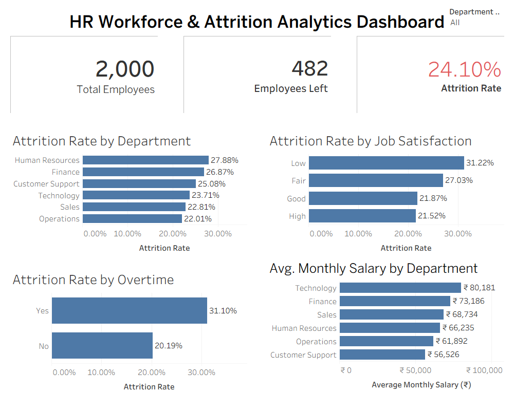
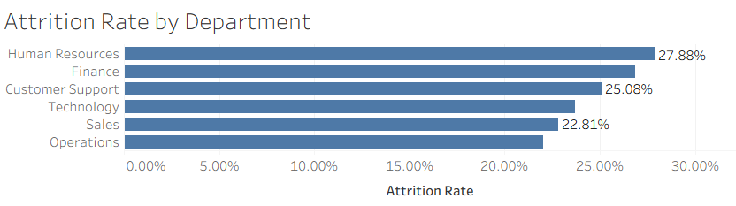
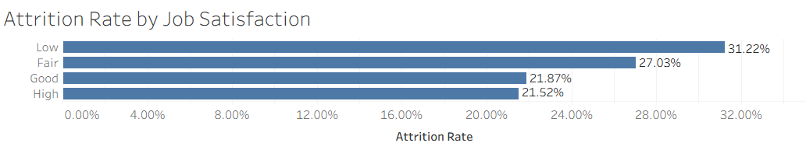
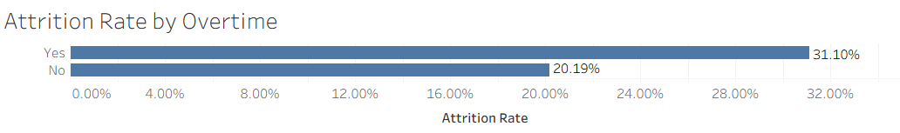
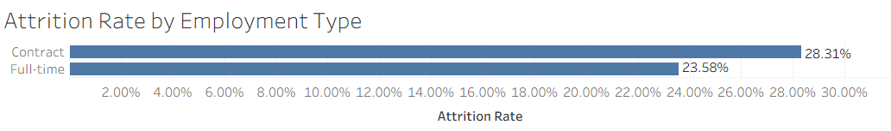
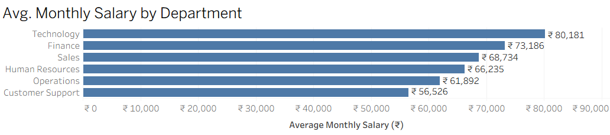

# HR Workforce & Attrition Analytics

## Project Overview

The **HR Workforce & Attrition Analytics** project is an end-to-end data analytics project created to analyze employee workforce data and understand patterns associated with employee attrition.

The project covers the complete analytics workflow using **Excel, SQL, Python, and Tableau**. The main focus was to clean and validate employee data, calculate key HR metrics, analyze attrition across different employee groups, and present the findings through an interactive Tableau dashboard.

The dataset used in this project is a **synthetic HR dataset containing 2,000 employees**.

---

## Project Objective

The main objectives of this project were to:

- Analyze the overall employee attrition rate.
- Identify departments with higher observed attrition.
- Compare attrition among employees working overtime and those not working overtime.
- Analyze the relationship between job satisfaction and attrition.
- Compare average monthly salaries across departments.
- Build an interactive HR analytics dashboard.
- Practice an end-to-end analytics workflow using multiple tools.

---

## Tools & Technologies

| Tool | Purpose |
|------|---------|
| Microsoft Excel | Data cleaning, validation, PivotTables and initial analysis |
| MySQL / MySQL Workbench | SQL-based data analysis and aggregation |
| Python | Basic exploratory data analysis and visualization |
| Pandas | Data handling and analysis in Python |
| Matplotlib | Python visualization |
| Tableau | Interactive dashboard development |
| VS Code | Python scripting and project documentation |

---

## Dataset

The cleaned dataset contains **2,000 employee records** and includes information such as:

- Employee ID
- Age
- Gender
- Department
- Job Role
- Location
- Education
- Hire Date
- Monthly Salary
- Total Experience
- Employment Type
- Overtime
- Job Satisfaction
- Work-Life Balance
- Performance Rating
- Training Hours
- Years Since Last Promotion
- Absence Days
- Commute Distance
- Exit Date
- Attrition

---

## Project Workflow

### 1. Excel – Data Cleaning & Initial Analysis

Excel was used as the first stage of the project to understand, clean, validate and prepare the dataset.

Major tasks included:

- Checked the structure and quality of all columns.
- Identified duplicate employee records.
- Removed **8 duplicate records**, leaving **2,000 unique employees**.
- Converted numeric values stored as text into proper numeric data types.
- Converted Hire Date and Exit Date into valid date formats.
- Standardized inconsistent department names and capitalization.
- Validated numeric ranges for age, experience, salary, training hours, absence days and other fields.
- Filled missing salary values with reasonable role-based values for the synthetic dataset.
- Retained missing Job Satisfaction values where they could not be reliably inferred.
- Validated Exit Date against employee Attrition status.
- Documented data-cleaning activities in a separate cleaning log.

Excel PivotTables and charts were then used for initial attrition analysis.

---

### 2. SQL – Workforce & Attrition Analysis

The cleaned dataset was imported into MySQL and analyzed using SQL.

SQL was used to calculate and compare:

- Total employees
- Employees who left the organization
- Overall attrition rate
- Department-wise attrition
- Overtime vs attrition
- Job Satisfaction vs attrition
- Employment Type vs attrition
- Salary-related workforce metrics

SQL concepts used included:

- `SELECT`
- `WHERE`
- `GROUP BY`
- `ORDER BY`
- Aggregate functions
- `CASE`
- Conditional calculations
- Percentage calculations

This stage helped verify the results obtained during the Excel analysis.

---

### 3. Python – Basic Exploratory Data Analysis

Python was intentionally kept as a smaller component of the project.

The cleaned HR dataset was analyzed using **Pandas** and a visualization was created using **Matplotlib**.

Python files include:

- `HR_Workforce_EDA.py`
- `Attrition_by_Overtime.png`

The Python analysis provided additional practice in loading datasets, performing basic analysis and creating programmatic visualizations.

---

### 4. Tableau – Interactive HR Dashboard

Tableau was used to build the final interactive visualization dashboard.

The dashboard contains three key HR KPIs:

- **Total Employees:** 2,000
- **Employees Left:** 482
- **Overall Attrition Rate:** 24.10%

The dashboard also includes:

- Attrition Rate by Department
- Attrition Rate by Job Satisfaction
- Attrition Rate by Overtime
- Average Monthly Salary by Department

A **Department filter** was added so users can dynamically analyze the dashboard for individual departments.

---

## Key Insights

### Overall Attrition

- Total Employees: **2,000**
- Employees Left: **482**
- Overall Attrition Rate: **24.10%**

Approximately one-fourth of the employees in the dataset left the organization.

### Department-wise Attrition

| Department | Attrition Rate |
|------------|---------------:|
| Human Resources | 27.88% |
| Finance | 26.87% |
| Customer Support | 25.08% |
| Technology | 23.71% |
| Sales | 22.81% |
| Operations | 22.01% |

Human Resources recorded the **highest observed attrition rate at 27.88%**, while Operations recorded the lowest among the six departments.

### Overtime and Attrition

| Overtime | Attrition Rate |
|----------|---------------:|
| Yes | 31.10% |
| No | 20.19% |

Employees working overtime showed a noticeably higher observed attrition rate than employees not working overtime.

This represents an **association in the dataset and does not by itself establish causation**.

### Job Satisfaction and Attrition

| Job Satisfaction | Attrition Rate |
|------------------|---------------:|
| Low | 31.22% |
| Fair | 27.03% |
| Good | 21.87% |
| High | 21.52% |

The observed attrition rate generally decreased as Job Satisfaction increased.

### Average Monthly Salary by Department

| Department | Average Monthly Salary |
|------------|-----------------------:|
| Technology | ₹80,181 |
| Finance | ₹73,186 |
| Sales | ₹68,734 |
| Human Resources | ₹66,235 |
| Operations | ₹61,892 |
| Customer Support | ₹56,526 |

Technology had the highest average monthly salary, while Customer Support had the lowest average salary among the analyzed departments.

---

## Tableau Dashboard

The final Tableau dashboard provides an interactive overview of workforce and attrition trends.

Main dashboard components:

- Total Employees KPI
- Employees Left KPI
- Attrition Rate KPI
- Department-wise Attrition
- Job Satisfaction vs Attrition
- Overtime vs Attrition
- Average Monthly Salary by Department
- Interactive Department Filter

The dashboard was designed to remain simple, readable and suitable for portfolio and resume presentation.

---


## Dashboard Preview

The final Tableau dashboard summarizes the key workforce and attrition metrics and includes an interactive Department filter.



---

## Supporting Visuals

### Attrition Analysis

<p align="center">
  
  
</p>

<p align="center">
  
  
</p>

### Salary Analysis

<p align="center">
  
</p>


## Project Structure

```text
HR_Workforce_Attrition_Analytics/
│
├── 01_Raw_Data/
│   └── HR_Workforce_Attrition_Raw.xlsx
│
├── 02_Excel/
│   └── HR_Workforce_Working.xlsx
│
├── 03_SQL/
│   ├── HR_Workforce_Cleaned.csv
│   └── HR_Workforce_Analysis.sql
│
├── 04_Python/
│   ├── HR_Workforce_Cleaned.csv
│   ├── HR_Workforce_EDA.py
│   └── Attrition_by_Overtime.png
│
├── 05_Tableau/
│   ├── HR_Workforce_Attrition_Dashboard.twbx
│   └── HR_Workforce_Cleaned.csv
│
├── 06_Report_Presentation/
│   ├── HR_Workforce_Attrition_Dashboard.png
│   ├── Attrition_Rate_by_Department.png
│   ├── Attrition_Rate_by_Job_Satisfaction.png
│   ├── Attrition_Rate_by_Overtime.png
│   ├── Attrition_Rate_by_Employment_Type.png
│   └── Avg_Monthly_Salary_by_Department.png
│
└── README.md

```


## Skills Demonstrated

- Data Cleaning
- Data Validation
- Excel PivotTables
- HR Data Analysis
- SQL Querying
- Data Aggregation
- Basic Python EDA
- Pandas
- Matplotlib
- Tableau Dashboard Development
- KPI Development
- Interactive Filtering
- Data Visualization
- Business Insight Generation

---

## Conclusion

This project demonstrates an end-to-end HR analytics workflow starting with raw employee data and progressing through **Excel cleaning, SQL analysis, basic Python EDA and Tableau visualization**.

The analysis found notable associations between employee attrition and factors such as **department, overtime and job satisfaction**.

The final Tableau dashboard provides an interactive and easy-to-understand view of the workforce, allowing HR-related metrics and attrition patterns to be explored at both the overall and department level.

---

## Note

This project uses a **synthetic dataset created for learning and portfolio purposes**. The findings demonstrate analytical techniques and should not be interpreted as conclusions about any real organization.